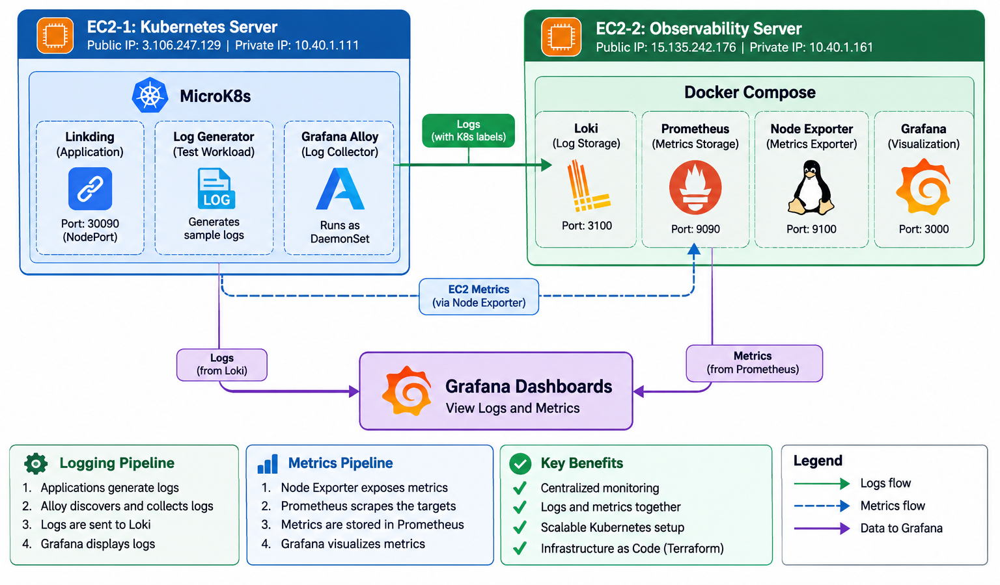

# System & Application Observability

A two-node observability reference architecture on AWS EC2 that separates application workloads from centralized monitoring. **EC2-1** runs containerized applications on MicroK8s alongside **Grafana Alloy** for log collection, while **EC2-2** runs the centralized observability stack (**Prometheus**, **Loki**, **Grafana**, and **Node Exporter**) via Docker Compose.



## Core Data Pipelines

### 1. Logging Pipeline (Push Model)
`Kubernetes Pods → Grafana Alloy → Loki → Grafana`

1. **Workloads emit logs:** Pods (`linkding`, `log-generator`) write structured and standard logs to `stdout`/`stderr`.
2. **Discovery & Collection:** The **Grafana Alloy** DaemonSet (`alloy-system` namespace) discovers pods scheduled on its local node via the Kubernetes API.
3. **Relabeling & Enrichment:** Alloy extracts Kubernetes metadata (`namespace`, `pod`, `container`, `app`) and attaches the static label `cluster="microk8s"`.
4. **Ingestion & Storage:** Alloy pushes log streams over the private network to **Loki** (`http://10.40.1.161:3100/loki/api/v1/push`), which indexes labels using TSDB (`v13` schema) and persists chunks on disk for **7 days** (`168h`).
5. **Querying:** **Grafana** queries Loki via LogQL for log exploration and error filtering.

### 2. Metrics Pipeline (Pull Model)
`Linux Hosts → Node Exporter → Prometheus → Grafana`

1. **Metric Exposure:** **Node Exporter** exposes host-level CPU, memory, disk, and network statistics at `:9100/metrics`.
2. **Scraping:** **Prometheus** scrapes configured targets every **15 seconds** (`prometheus:9090`, `loki:3100`, `10.40.1.161:9100`, and `10.40.1.111:9100`) and stores time-series data for **15 days**.
3. **Visualization:** **Grafana** queries Prometheus via PromQL as the default data source.

---

## Repository Structure

```text
.
├── compose.yaml                                    # Docker Compose stack for EC2-2 (Prometheus, Loki, Grafana, Node Exporter)
├── .env.example                                    # Environment variable template for Grafana
├── prometheus/
│   └── prometheus.yml                              # Scrape intervals and static target definitions
├── loki/
│   └── config.yml                                  # Loki TSDB storage, filesystem, and 7-day retention settings
├── grafana/
│   └── provisioning/
│       └── datasources/
│           └── datasources.yml                     # Auto-provisioned Prometheus & Loki data sources
├── kubernetes/
│   ├── namespace.yaml                              # Creates the `observability-demo` namespace
│   ├── workload.yaml                               # `log-generator` Deployment emitting periodic JSON info/error logs
│   ├── alloy-values.yaml                           # Helm values placeholder for Alloy
│   ├── alloy/
│   │   ├── alloy.yaml                              # Alloy Namespace, RBAC, ConfigMap, and DaemonSet manifests
│   │   └── config.alloy                            # Standalone Alloy River configuration reference
│   └── linkding/
│       └── linkding.yaml                           # Linkding PVC (2Gi), Deployment, and NodePort (:30090) Service
├── alerting/
│   └── configuration-notes.md                      # Notes for alerting setup (placeholder)
└── scripts/
    └── traffic-test.sh                             # Traffic testing script (placeholder)
```

---

## Network & Component Matrix

| Component | Host | Port | Protocol / Access | Role |
| --- | --- | --- | --- | --- |
| **Linkding** | EC2-1 (`10.40.1.111`) | `30090` | HTTP (`NodePort`) | Sample self-hosted bookmark application (`linkding` namespace) |
| **Log Generator** | EC2-1 (`10.40.1.111`) | — | Internal Pod | Emits JSON info logs every 5s and error logs every 7th event |
| **Grafana Alloy** | EC2-1 (`10.40.1.111`) | `12345` | HTTP (Cluster internal) | DaemonSet collecting and shipping Pod logs to Loki |
| **Loki** | EC2-2 (`10.40.1.161`) | `3100` | HTTP (Private VPC) | Log aggregation and TSDB filesystem storage (`168h` retention) |
| **Prometheus** | EC2-2 (`10.40.1.161`) | `9090` | HTTP (`127.0.0.1` + Docker net) | Time-series metrics scraper (`15s` interval, `15d` retention) |
| **Node Exporter** | EC2-2 (`10.40.1.161`) | `9100` | HTTP (Private VPC) | Exposes Linux host metrics for Prometheus scraping |
| **Grafana** | EC2-2 (`10.40.1.161`) | `3000` | HTTP | Unified dashboard UI for Prometheus and Loki |

> **Security Note:** Inter-node telemetry (`Alloy → Loki` and `Prometheus → Node Exporter`) travels exclusively over private VPC IP addresses (`10.40.1.0/24`) rather than public interfaces.

---

## Deployment & Usage

### Prerequisites
- **EC2-1:** Ubuntu/Linux with MicroK8s (`kubectl` enabled) and network access to `10.40.1.161:3100`.
- **EC2-2:** Docker and Docker Compose v2, with security group rules permitting `3100/tcp` and `9100/tcp` from EC2-1 (`10.40.1.111`) and `3000/tcp` for authorized Grafana access.

### 1. Start the Observability Stack (EC2-2)

```bash
# Create your environment file and configure credentials before starting
cp .env.example .env

# Ensure Loki config path matches compose.yaml (or update the volume mount to ./loki/config.yml)
docker compose up -d
```

Verify running services:
```bash
docker compose ps
```

### 2. Deploy Workloads & Log Collector (EC2-1)

```bash
# Deploy the demo log generator
kubectl apply -f kubernetes/namespace.yaml
kubectl apply -f kubernetes/workload.yaml

# Deploy Linkding (create the required secret in the `linkding` namespace first)
kubectl create namespace linkding
kubectl create secret generic linkding-secret -n linkding \
  --from-literal=LD_SUPERUSER_NAME=admin \
  --from-literal=LD_SUPERUSER_PASSWORD=<your-password>
kubectl apply -f kubernetes/linkding/linkding.yaml

# Deploy Grafana Alloy DaemonSet.
kubectl apply -f kubernetes/alloy/alloy.yaml
```

### 3. Verify in Grafana

Open Grafana at `http://<EC2-2-HOST>:3000` (with **Prometheus** and **Loki** pre-provisioned) and test queries in **Explore**:

- **LogQL (all demo logs):**
  ```logql
  {cluster="microk8s", namespace="observability-demo"}
  ```
- **LogQL (simulated errors only):**
  ```logql
  {app="log-generator"} |= "error"
  ```
- **PromQL (host CPU / availability):**
  ```promql
  up
  ```
